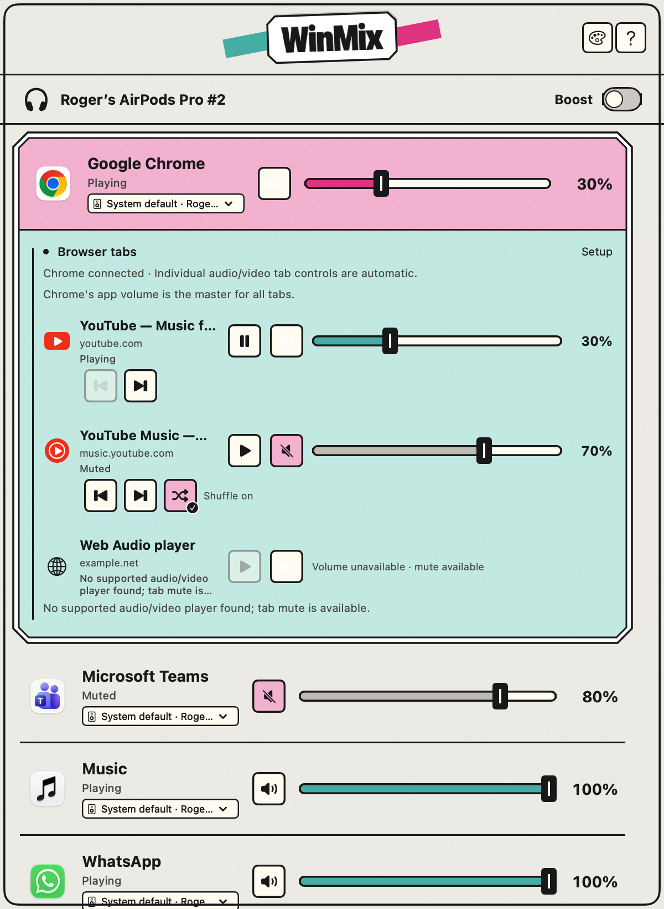
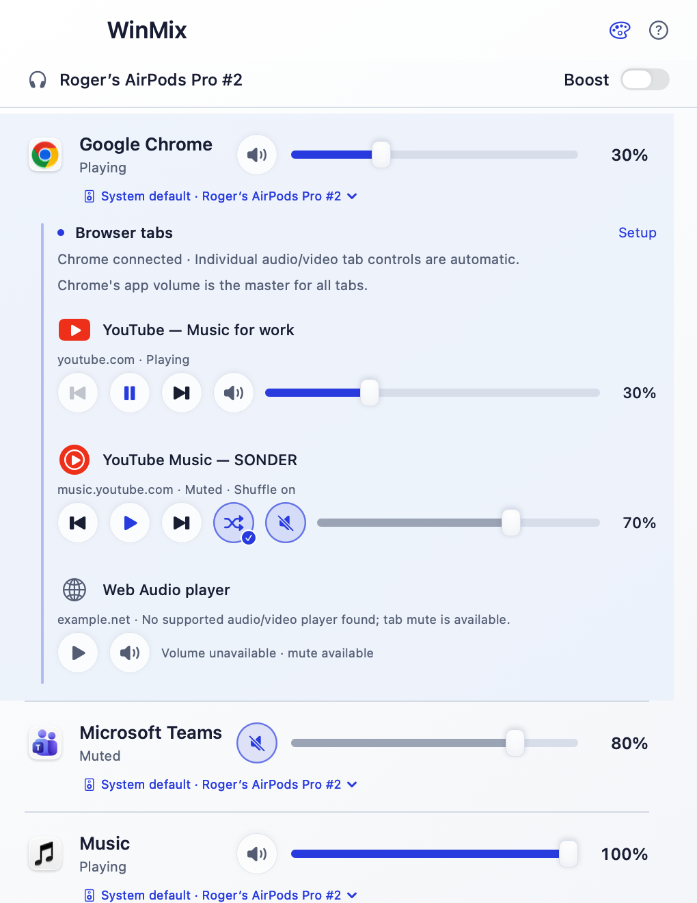
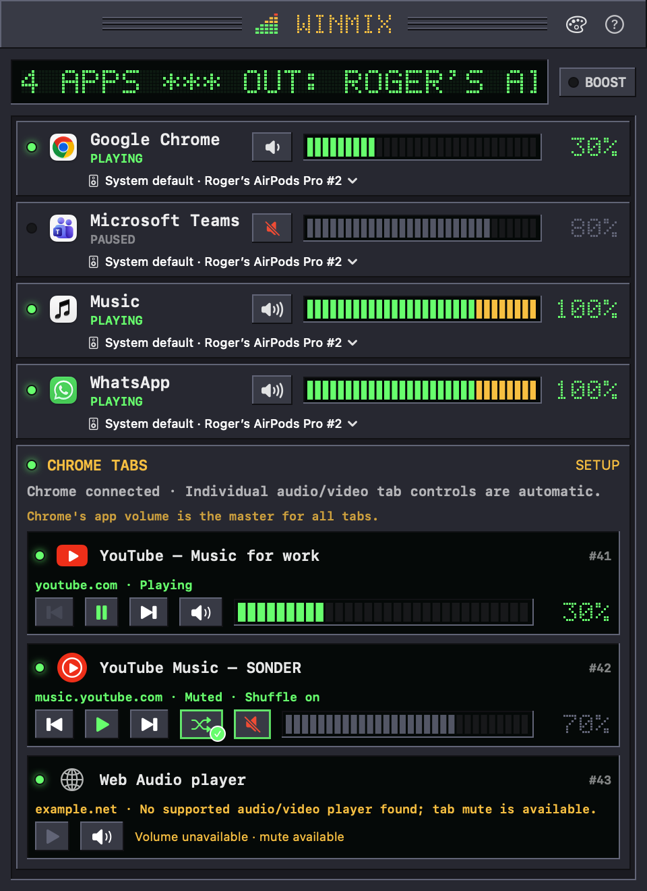
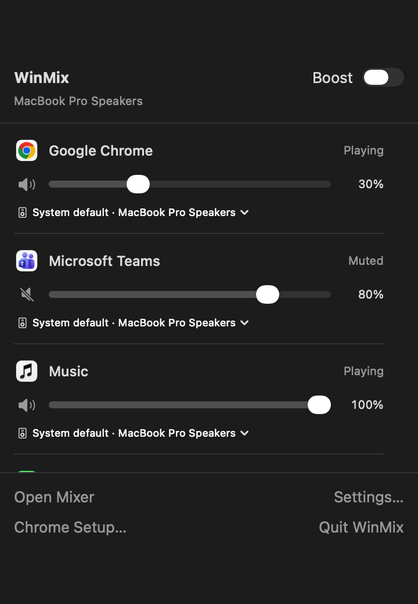

# WinMix

**Per-app and per-tab volume control for macOS.** Turn Chrome down to 30%, mute Teams,
send Music to your speakers while calls stay on your AirPods, and control each YouTube tab
on its own — without installing an audio driver.

WinMix is a native Swift app built on Core Audio process taps (macOS 14.4+). It is macOS only,
despite the name.

<p align="center">
  
</p>

## Features

- **Volume and mute per app.** Every app that plays audio gets its own row. Helper processes
  (Chrome Helper, WebKit GPU, …) are grouped under the app that owns them.
- **Boost up to 200%**, with a soft clipper so loud sources don't distort.
- **Output device per app.** Pin any app to a specific output without changing the Mac's system
  output. If that device disconnects, the app falls back to the system output and returns when
  the device reconnects.
- **Individual Chrome tabs.** With the companion extension, every audio/video tab gets its own
  volume, mute and play/pause. YouTube and YouTube Music also get previous, next and shuffle.
  Chrome's app slider stays the master for all tabs.
- **Menu-bar mini mixer** for quick changes; the full mixer window for everything else.
- **Three appearances:** Sticker Case, Ceramic and Retro (a nod to classic desktop media players).
- **Remembers your settings** per app (by bundle ID) and can launch at login.
- **No virtual audio driver, no kernel extension.** WinMix uses Apple's public process-tap API.

| Ceramic | Retro | Menu bar |
|---|---|---|
|  |  |  |

## Requirements

- macOS **14.4** or later (Core Audio process taps)
- To build: Xcode 16 or the Swift 6 toolchain
- For per-tab control: Google Chrome 116 or later

## Install

There are no pre-built releases yet, so build from source:

```sh
git clone https://github.com/rogeraleite/WinMix.git
cd WinMix
./scripts/build-app.sh
open build/WinMix.app
```

Move `build/WinMix.app` to wherever it will live (for example `/Applications`) before enabling
**Launch at login** in WinMix → Settings (⌘,), because macOS remembers the app's path.

On first use macOS asks for **System Audio Recording** access. If the level meters stay at zero,
check System Settings → Privacy & Security → Screen & System Audio Recording. The build is
ad-hoc signed, so macOS may ask again after each rebuild.

## Usage

Click the slider icon in the menu bar to change each app's volume, mute, output or Boost.
**Open Mixer** opens the full window, including Chrome tabs and the appearance menu (palette icon).
Closing the window keeps WinMix and its audio controls running; **Quit WinMix** stops them.

### Chrome tab control (optional)

1. In WinMix, open **? → Chrome Setup**.
2. Open `chrome://extensions`, enable **Developer mode** and click **Load unpacked**. Choose the
   bundled **ChromeExtension** folder (the setup sheet has a shortcut to it).
3. Paste the extension's 32-letter ID into the setup sheet and click **Connect browser**.
4. Click **Reconnect to WinMix** in the WinMix Tabs extension popup.

No Terminal is needed. Tabs that play audio or video on HTTP/HTTPS sites then appear
automatically under the Chrome row.

**Privacy:** the extension requests `tabs` and HTTP/HTTPS site access so it can find tabs that
are playing and control their HTML audio/video players. It does not capture audio and does not
send page content anywhere; it only talks to WinMix on your Mac through Chrome's Native Messaging.

**Limits:** per-tab volume works for HTML `<audio>`/`<video>` players. Internal Chrome pages,
the Web Store, local files and pure Web Audio output can't be turned down individually; WinMix
says so and offers tab mute instead. Detailed guide (Portuguese):
[docs/chrome-tab-volume.md](docs/chrome-tab-volume.md).

## How it works

`AudioProcessMonitor` watches Core Audio's process list, and `AppOwner` maps each process to the
app responsible for it (Chrome Helper → Chrome; shared WebKit GPU processes → the app that uses
them). `MixerModel` shows one row per playing app and runs a tap for an app only while it is away
from 100%, muted, or pinned to a specific output.

For each tapped app, `ProcessVolumeTap` creates a process tap with `.mutedWhenTapped` (the app's
normal output goes silent while WinMix reads it), wraps it in a private aggregate device whose main
sub-device is the chosen output, and in the IO callback copies tap → output multiplied by the gain.
New helper processes join the running tap as soon as they appear, before they play, so they never
sound at full volume.

To change device, WinMix builds a complete new route (its own tap and aggregate), waits for its
first IO callback and only then destroys the old one, so the app is never left playing unmuted.
The same move rebuilds routes after wake, and a 3-second watchdog rebuilds any route whose IO has
stopped.

Measured on a MacBook Pro: gain applied exactly (out/in 0.300 at 30%), about 7 ms added latency,
WinMix CPU 0.2–0.6%. Details in the [engineering log](docs/engineering-log.md).

The Chrome extension (`Extensions/Chrome`) talks to the `ChromeBridge` Native Messaging host,
which relays tab state and commands to the app over a local socket.

## Known limitations

- A `coreaudiod` restart isn't handled yet; relaunch WinMix.
- Builds are ad-hoc signed and not notarized.
- Per-tab control is Chrome-only for now.

## Project layout

```
Sources/WinMix/         macOS app (SwiftUI/AppKit, Core Audio taps, mixer model)
Sources/ChromeSupport/  shared message protocol and local socket
Sources/ChromeBridge/   Native Messaging host launched by Chrome
Extensions/Chrome/      WinMix Tabs extension (Manifest V3)
Tests/                  Swift, extension (Node) and installer (Python) tests
scripts/                build, icon and bridge scripts
docs/                   setup guides, validation records, engineering notes
```

## Contributing

Issues and pull requests are welcome. Before opening a PR, run the test suites:

```sh
swift test
node --test Tests/ChromeExtension/*.test.mjs
python3 -m unittest discover -s Tests -p 'test_*.py'
```

[docs/development.md](docs/development.md) covers headless probe modes for testing taps and
devices, rendering UI previews without touching audio, and regenerating icons.

## Name

The name and Retro look are a tribute to Winamp. WinMix is an independent project, not affiliated
with or endorsed by Winamp. It was previously called MacVolume; older validation records in
`docs/` keep that name.

## License

Copyright (C) 2026 Roger Leite. WinMix is free software under the
[GNU General Public License v3.0](LICENSE).
